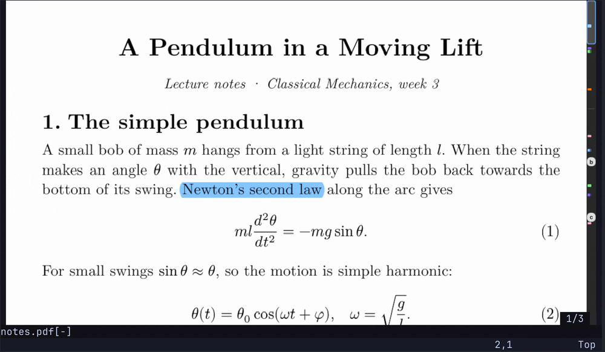
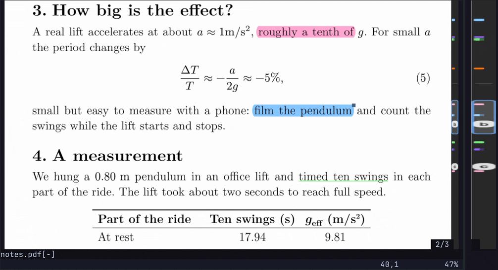
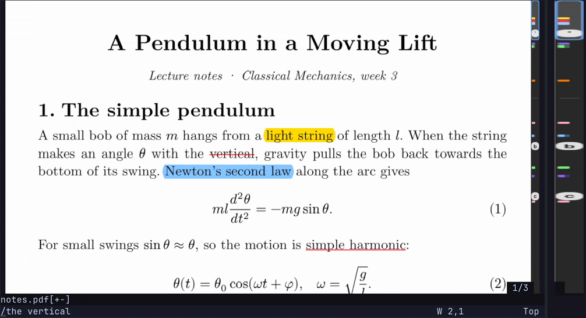
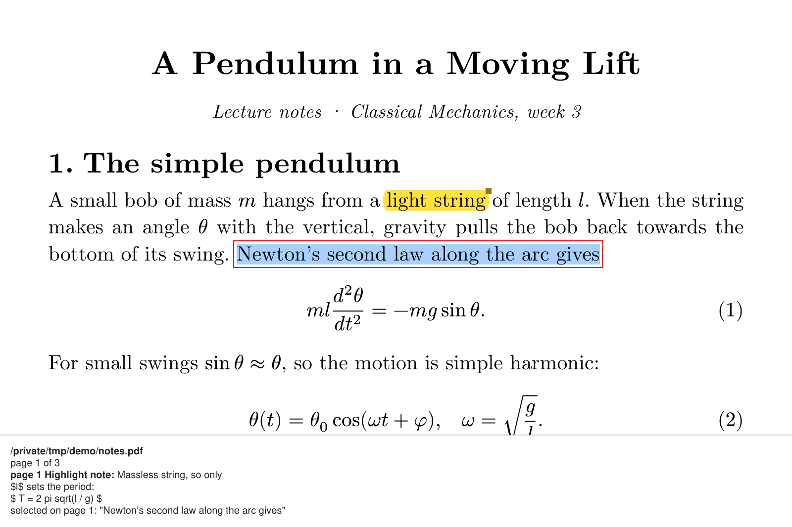
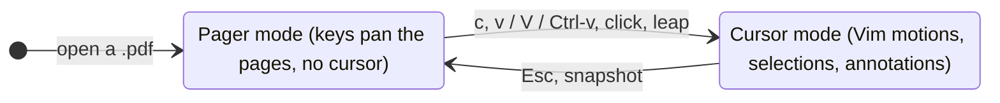
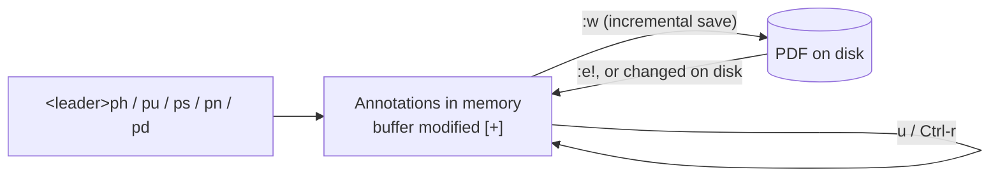
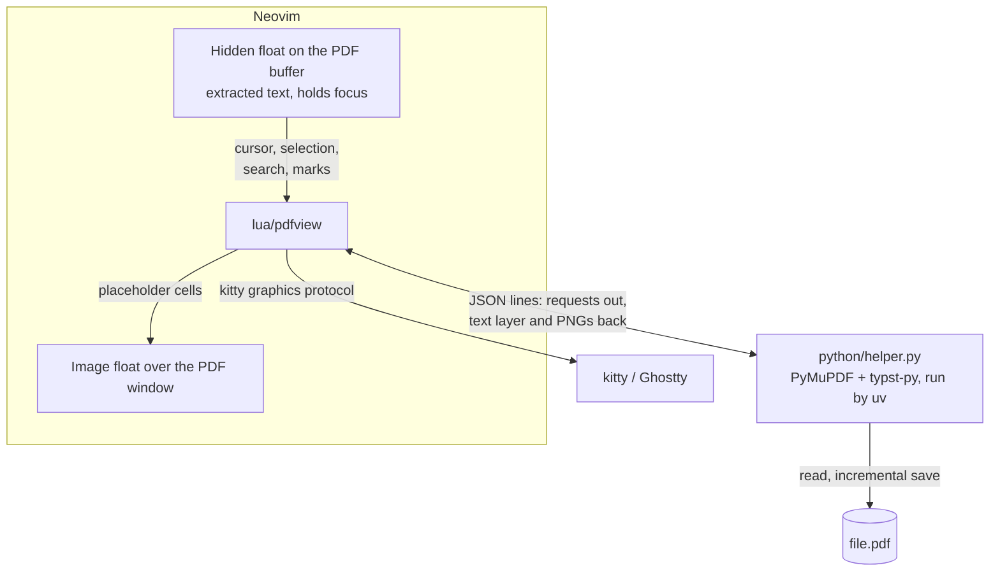

# pdfview.nvim

Read and annotate PDFs in Neovim with ordinary Vim motions, write notes in Typst, and
hand what you are looking at to an AI agent as one captioned image.


- **Rendered pages in the terminal** (kitty or Ghostty), stacked for continuous scrolling.
- **Vim on the real text**: motions, `/` search, marks, visual mode and yanking.
- **[Leap](#jump-to-anything-you-can-see) to any word on screen**, maths included.
- **[Annotations](#annotate)** that are standard PDF annotations, so other viewers show them too.
- **[Typst notes](#notes-in-typst-with-live-preview)** with a live preview.
- **[A scrollbar for the whole document](#the-whole-document-in-the-scrollbar)**, with
  annotations, search matches and marks on it.
- **[Snapshots for agents](#snapshots-for-agents)**: one PNG with the page, your selection
  and a caption.

## Tour

The clips use a short set of lecture notes; the keys pressed appear in the middle of the
statusline (`<leader>` is Space). [doc/demo](doc/demo/README.md) has the notes and how the
clips were recorded.

### Read like a pager, move like Vim

Opening a `.pdf` fills its window with the rendered pages in pager mode: like `less` or
Vimium, keys pan the pages and no cursor is drawn. `c` switches to cursor mode for
selecting and annotating. The text layer stays hidden: `hjkl`, `w`, `/`, `n`, marks,
visual mode and yanking still operate on real buffer text. In cursor mode the view
follows the cursor, tints its line or visual selection, and marks the character under
the cursor; the cursor becomes hollow when you leave the PDF window or the terminal loses
focus.

To read the extracted text (reading order, what a yank copies), `:split` the PDF
window: other windows on the buffer show its text as usual.

### Jump to anything you can see



With [leap.nvim](https://codeberg.org/andyg/leap.nvim), pdfview supplies targets for
everything visible on the rendered pages, including text outside the hidden text
window's viewport and in other columns. Your keys mapped to `<Plug>(leap)` are
automatically overridden in PDF buffers (or set `keys.leap` explicitly). Type two
characters, then use Leap's usual labels, autojump and traversal. Matching is
case-insensitive and respects Leap's equivalence classes. Labels appear after the
second character: Leap's first-character preview is not used, and repeating a
custom-target jump asks for its characters again.

Labels are mirrored through Leap's `on_beacons` hook (any existing hook is preserved).
They snap to terminal cells, so very close matches can share a label cell.

### Annotate


Select text and press `<leader>ph`, `<leader>pu` or `<leader>ps` to highlight, underline
or strike it out; `u` and `<C-r>` undo and redo, and `:w` saves into the PDF. The blue,
green, pink and purple ones in the clips were made in another PDF reader: pdfview shows,
lists, edits and deletes those too, and other viewers show yours. See
[Annotations and saving](#annotations-and-saving).

### Notes in Typst, with live preview


`<leader>pn` on a selection highlights it and opens a [Typst](https://typst.app/docs/)
note: source on one side, a preview that re-renders as you type on the other. `q` saves
and closes; `K` shows the note rendered. A small square past the end of an annotation
marks that it carries a note. See [Typst notes](#typst-notes).

### Marks remember the view



Marks (`m`) and jumps remember the page view: `'a`, `` `a ``, `''`, `<C-o>` and `<C-i>`
return to the exact view a mark was set or a jump left from, when the target is out of
view. Other moves scroll just enough to show the cursor.

### The whole document in the scrollbar



The panel on the far right of these two clips is the scrollbar magnified three times
sideways for the recording; in Neovim it is the thin bar beside it.

A document-wide scrollbar at the right edge shows the whole PDF: hairlines between
pages, annotations in their own colour (darker at the end when they carry a note),
lines matching the search in orange, marks `a`–`z` and `'` (where `''` returns to) as
labelled pills, the cursor line in cursor mode as a blue rule, and a see-through thumb
over the part in view. A badge beside its bottom end shows the page in the middle of
the view and the page count, after `CURSOR` in cursor mode (highlight `PdfViewPage`,
linked to `StatusLine`).

### Snapshots for agents



`<leader>py` turns what you see into one PNG for an AI agent (copied to the clipboard on
macOS). See [Snapshots for agents](#snapshots-for-agents-1).

## Requirements

- Neovim 0.12+.
- [uv](https://docs.astral.sh/uv/getting-started/installation/) on `$PATH`. The PDF work
  is done by a small Python script run with `uv run --script`; on first use uv installs
  Python (3.11+, if you have none), [PyMuPDF](https://pymupdf.readthedocs.io/) and the
  [Typst](https://typst.app/) compiler ([typst-py](https://github.com/messense/typst-py))
  from the script's lock file into an isolated, cached environment. This takes a few
  seconds once and needs network access. No pip, virtualenv or Typst command-line tool
  is needed.
- [kitty](https://sw.kovidgoyal.net/kitty/) or [Ghostty](https://ghostty.org/), with
  `'termguicolors'` on. Elsewhere (including inside tmux) PDFs are not opened.
- macOS, or Linux on x86_64 or aarch64 with glibc 2.28+ (or x86_64 musl): the platforms
  with prebuilt PyMuPDF and typst wheels.
- For copying snapshots to the clipboard: macOS. On other systems the snapshot is saved and
  its path is shown.

## Installation

With `vim.pack`:

```lua
vim.pack.add { 'https://github.com/james-yap/pdfview.nvim' }
require('pdfview').setup()
```

With [lazy.nvim](https://github.com/folke/lazy.nvim):

```lua
{ 'james-yap/pdfview.nvim', opts = {} }
```

`setup()` is required: it registers the handler that opens `*.pdf` files (lazy.nvim's
`opts = {}` calls it). Then run `:checkhealth pdfview`: it checks the Neovim version,
the terminal, uv, and that the helper starts, which also installs its dependencies
ahead of the first PDF.

## Configuration

Defaults:

```lua
require('pdfview').setup {
  -- Buffer-local keys in PDF buffers; set any of them to false to skip it.
  -- A list maps several keys to the same action.
  keys = {
    prefix = '<leader>p', next_annotation = ']a', prev_annotation = '[a', leap = nil,
    next_page = { ']p', '<PageDown>' }, prev_page = { '[p', '<PageUp>' },
    hover = 'K', undo = 'u', redo = '<C-r>',
  },
  -- leap = nil: use keys mapped to <Plug>(leap); a string sets a key; false disables it.
  -- Where snapshots are written. nil: $TMPDIR/pdfview.
  snapshot_dir = nil,
  -- Size of rendered Typst notes; 1 makes their text about as large as the terminal's.
  -- A note still shrinks to fit its window.
  typst_scale = 1.2,
}
```

## Keys

Keys are only mapped in PDF buffers (`x` is visual mode).

| Key | Mode | Action |
| --- | --- | --- |
| `<leader>py` | n, x | Snapshot for an agent (see below) |
| `<leader>ph` | x | Highlight the selection |
| `<leader>pu` | x | Underline the selection |
| `<leader>ps` | x | Strike out the selection |
| `<leader>pn` | x | Highlight the selection and write a Typst note on it |
| `<leader>pn` | n | Edit the note of the annotation under the cursor |
| `<leader>pd` | n | Delete the annotation under the cursor |
| `<leader>pl` | n | List all annotations in the quickfix list |
| `K` | n | Preview the note under the cursor; press again to focus the preview |
| `u` / `<C-r>` | n | Undo / redo annotation changes (takes a count) |
| `]a` / `[a` | n | Next / previous annotation (takes a count) |

An annotation that carries a note shows a small square in a darker shade of its colour
just past its end, like a footnote mark; the mark is drawn on screen only, never into
the PDF. `K` uses Neovim's hover-style preview, without requiring an LSP server. Moving
the PDF cursor dismisses it; after focusing it with a second `K`, use `q` or `<Esc>` to
close. Viewing a note never marks the PDF modified.

`<leader>pn` opens the note editor (see [Typst notes](#typst-notes)): `:w` saves the
note into the in-memory PDF, and `q` saves and closes. Saving an empty note removes it,
leaving a plain highlight. Text editing inside this window uses its own normal Neovim
undo history.

These keys operate on the rendered view in both modes (in normal and visual mode); in
other windows on the buffer they keep their native behaviour:

| Key | Action |
| --- | --- |
| `<C-e>` / `<C-y>` | Scroll down / up a terminal row (takes a count) |
| `<C-d>` / `<C-u>` | Scroll half a view; an explicit count scrolls that many rows |
| `<C-f>` / `<C-b>` | Scroll down / up a view with two rows of overlap (takes a count) |
| Mouse wheel | Scroll the pages |
| `zt` / `zz` / `zb` | Put the cursor line near the top / middle / bottom |
| `H` / `M` / `L` | Move to a line near the top / middle / bottom |
| `]p` / `[p`, `<PageDown>` / `<PageUp>` | Scroll to the top of the next / previous page; `[p` inside a page goes to its top first (takes a count) |
| Left click | Move to the character you clicked |

Scrolling keeps the cursor in view where there is text. Search still covers the whole
document; incremental and last-search matches are tinted on the rendered pages, the
match under the cursor in orange so `n`/`N` stand out in pager mode too.
Selections and yanks use the extracted text's reading order, not a two-dimensional
screen rectangle. Use `v` or `V` for selection; mouse dragging is not used.

### Pager and cursor mode

PDFs open in pager mode. The cursor is not drawn but stays on the top line in view, so
cursor mode starts where you are reading. In pager mode:

| Key | Action |
| --- | --- |
| `j` / `k`, `<Down>` / `<Up>`, `<CR>` | Pan down / up three rows (takes a count) |
| `d` / `u` | Pan half a view; an explicit count pans that many rows |
| `gg` / `G` | Pan to the start / end |
| `c` | Cursor mode |



`v` / `V` / `<C-v>`, a click on a page and leap (as soon as it starts) also enter
cursor mode. `<Esc>` in normal mode returns to pager mode (it ends a selection first,
and cancelling a leap with it returns too); your own `<Esc>` mapping, such as
`:nohlsearch`, still runs. A snapshot (`<leader>py`) also returns to pager mode. In
cursor mode the pager keys do what they do in Vim, and `u` undoes annotation changes.

## Annotations and saving

The PDF buffer behaves like a file you edit:

- Annotation changes are kept in memory and mark the buffer as modified.
- `:w` writes them into the PDF (an incremental save, so the rest of the file is untouched).
  `:w other.pdf` writes a copy.
- `:e!` reloads the PDF from disk and discards unsaved annotations; `:e` refuses while there
  are unsaved changes.
- `u` / `<C-r>` undo and redo annotation creation, deletion and note saves. History
  uses Neovim's native undo tree in a separate hidden annotation-state buffer, so the
  extracted text and ordinary PDF navigation remain unchanged.
- `:w` preserves that history. Undoing away from the saved state marks the PDF
  modified again; returning to it clears the modified flag. Reloading starts fresh.
- History is session-only: there is no on-disk annotation autosave or crash recovery.



Statuslines must include `%m` to show the usual `[+]` for unsaved changes. The
visible PDF window is technically inactive because a hidden float holds
keyboard focus. If using `mini.statusline`, include `%m` in its inactive content:

```lua
require('mini.statusline').setup {
  content = {
    inactive = function() return '%#MiniStatuslineInactive#%F%m%=' end,
  },
}
```

Highlights, underlines, strikethroughs, squiggly underlines and text notes made by other
programs are shown, listed, and can be edited or deleted as well.

When the PDF changes on disk (for example, LaTeX recompiling it), the buffer reloads by
itself. If you have unsaved annotations it warns instead, and `:w` refuses to overwrite the
newer file; `:e!` picks up the new version.

### Typst notes

Notes you write in pdfview are [Typst](https://typst.app/docs/) documents, so they can
hold maths: `$ V = L^3 \ (d V)/(d T) = 3 L^2 (d L)/(d T) $`. `<leader>pn` edits a note in
a source window beside a live preview that re-renders as you type, side by side on a
wide screen and stacked on a tall one. Compile errors appear as diagnostics on their
lines while the preview keeps the last version that compiled. `K` shows the note
rendered (or its source if it does not compile), in the float's colours.

The note takes its natural width, wrapping at the width of the window, and shrinks to
fit if it is taller. Packages (`#import "@preview/physica:0.9.3": *`) are downloaded on
first use into Typst's usual cache, shared with the `typst` command if you have it.
Notes cannot read files from your disk.

A note is stored as the Typst source in the annotation's ordinary note text, marked with
a private `/PdfviewTypst` key, so other PDF viewers show the source as a plain note.
Notes written by other programs lack the key and `K` shows them as plain text (Markdown);
editing one with `<leader>pn` and saving turns it into a Typst note.

## Snapshots for agents

`<leader>py` captures the visible regions of the stacked pages, with the visual
selection tinted and boxed in red, and adds a caption strip below it:

- the PDF's absolute path,
- the visible pages and the page count,
- the text of every note visible on those parts of the pages,
- the selected text (up to 300 characters), or in cursor mode without a selection, the
  cursor's page and the text around it with the character in brackets. The image marks
  that character with a red box and a small "x" around it.

The result is one PNG, so it works both in a local agent harness (via its path) and in a
web chat (paste the image). Vision models read the page text from the image; the caption
carries what the image cannot show, such as where the page lives on disk, the note text
and the exact text you mean.

## How it works



- `python/helper.py` (PyMuPDF) extracts the text with each character's position, renders
  page regions, edits annotations, builds snapshots and renders Typst notes (typst-py).
  Neovim talks to one helper process
  per session over JSON lines. View backgrounds use native bulk fills and the scrollbar
  is drawn as vector shapes on a small page, then rasterized in one call, avoiding
  Python per-pixel loops on navigation updates.
- A non-focusable image float covers the normal PDF window. A second,
  hidden float on the text buffer holds focus and inherits the window's jumplist and
  alternate file. Vim handles ordinary text motions and operators; pdfview only maps
  view-specific controls. Buffer switches from the hidden float are handed back to the
  normal window; closing it closes the PDF window too.
- The image uses the kitty graphics protocol with Unicode placeholders
  (`lua/pdfview/kitty.lua`): the image is drawn through placeholder characters in the pane
  buffer, so splits and floating windows cover it correctly. Rendered pages are handed to
  the terminal as temporary files, which the terminal deletes after reading.

Filetypes: `pdfview` (text buffer), `pdfview_page` (image float). Highlight groups, all
overridable: `PdfViewHighlight`, `PdfViewUnderline`, `PdfViewStrikeOut`,
`PdfViewSquiggly`, `PdfViewNote`, `PdfViewPage`.

## Troubleshooting

Start with `:checkhealth pdfview`.

| Message | Fix |
| --- | --- |
| `pdfview needs uv on $PATH` | Install [uv](https://docs.astral.sh/uv/getting-started/installation/) and make sure the `PATH` Neovim starts with includes it (GUI launchers often miss `~/.local/bin`). |
| `no page view: needs kitty or Ghostty` / `tmux is not supported` | Open the PDF in kitty or Ghostty, outside tmux. |
| `PDF helper exited (…): Failed to download …` | The first run downloads PyMuPDF and typst from PyPI. Behind a proxy set `HTTPS_PROXY`; for a mirror set `UV_INDEX_URL`. |
| `PDF helper timed out` | The first install took longer than two minutes. Run `:checkhealth pdfview` (it waits for the install), then reopen the PDF. |
| `needs Neovim 0.12 or newer` | Upgrade Neovim. |

## Limitations

- The text order is the PDF's content order. Multi-column layouts and math can come out in
  an awkward order; the rendered pages and snapshots show the real layout.
- Scanned PDFs (no text layer), encrypted PDFs and rotated pages are not supported.
- A selection (for annotations or snapshots) must stay on one page.
- Search highlighting is line-local (multi-line patterns still navigate through native
  search). The text layer must contain the characters you want to search or jump to.
- One rendered view is kept per PDF buffer; additional splits of that buffer can show
  its extracted text.

## Checks

```sh
uv run --with 'pymupdf>=1.26,<1.27' --with 'typst>=0.15,<0.16' tests/test_helper.py
```

This checks continuous page composition, clipping, hit testing, snapshots, hollow
cursors, visual selection repainting while an earlier mode callback waits for input,
note previews, Typst notes (live preview, diagnostics, rendered hover), native annotation
undo/redo, modified-state transitions and lossless annotation restoration through saves
(including repaired PDFs).
The headless Neovim checks use the real helper, replacing only terminal graphics.
To include the Leap regression (jumping
to visible page text outside the hidden text viewport), set `PDFVIEW_LEAP_RTP` to
your installed `leap.nvim` directory when running the command.

## License

[AGPL-3.0](LICENSE). pdfview.nvim depends on PyMuPDF, which is also AGPL-3.0.
