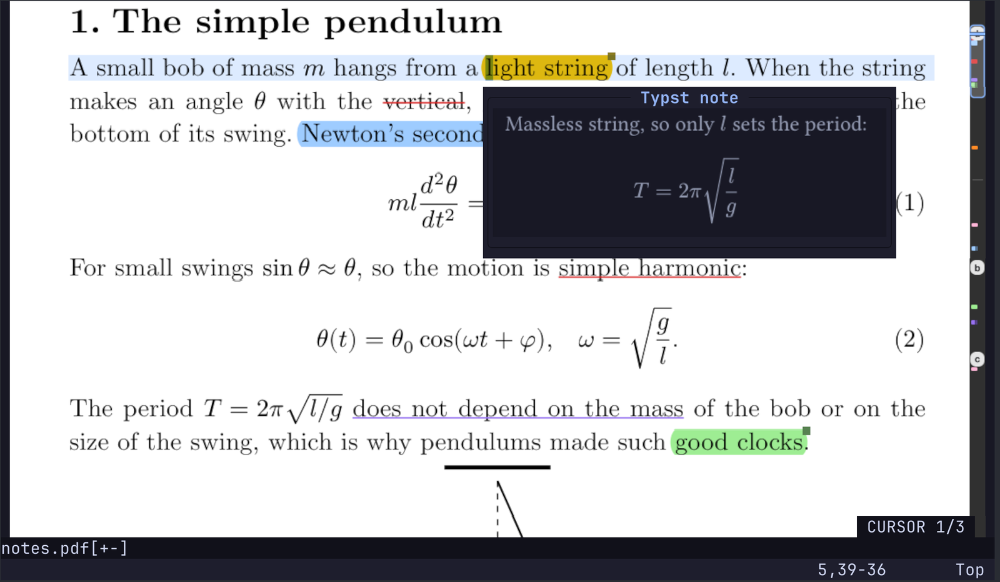
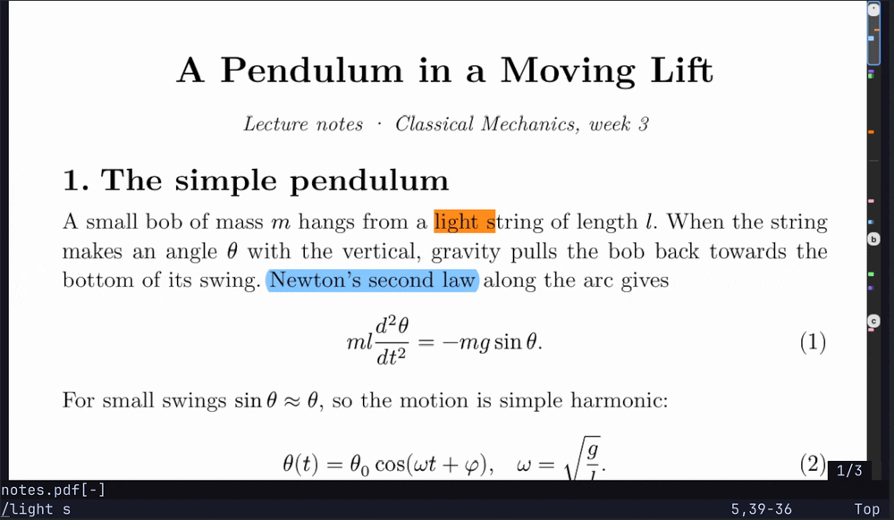

# pdfview.nvim

Read and annotate PDFs in Neovim, with the Vim motions you already know.



## Contents

- [Features](#features)
- [Requirements](#requirements)
- [Install](#install)
- [Basics](#basics)
- [Configuration](#configuration)
- [Documentation](#documentation)
- [License](#license)

## Features

The keys pressed in each clip appear at the bottom of the screen. `<leader>` is Space.

### Annotate


Select text, then press `<leader>ph` to highlight it, `<leader>pu` to underline it or
`<leader>ps` to strike it out. `:w` saves into the PDF, so other PDF viewers show your
annotations, and pdfview shows theirs.

### Notes in Typst



`<leader>pn` on a selection opens a note with a live preview. Notes are written in
[Typst](https://typst.app/docs/), so they can hold maths. `K` shows the note under the
cursor.

### Scrollbar


The scrollbar maps the whole document: annotations, search matches and marks. The clip
adds an enlarged copy of the bar on the right.

### Marks


Marks remember the view. `ma` sets mark `a`, and `'a` brings back the page exactly as
it was.

### Snapshots for agents


`<leader>py` turns what you see into one image for an AI agent: the page, your selection
boxed in red, and a caption with the file, the page, its notes and the selected text.

### Leap


With [leap.nvim](https://codeberg.org/andyg/leap.nvim) installed, your Leap key jumps to
any word on the page, maths included: type two characters, then the label.

## Requirements

- Neovim 0.12 or newer.
- [kitty](https://sw.kovidgoyal.net/kitty/) or [Ghostty](https://ghostty.org/), not
  inside tmux.
- [uv](https://docs.astral.sh/uv/getting-started/installation/). It installs everything
  else (Python, PyMuPDF and Typst) by itself, once, which needs an internet connection.
- macOS or Linux ([details](docs/troubleshooting.md#supported-platforms)).

## Install

With `vim.pack`:

```lua
vim.pack.add { 'https://github.com/james-yap/pdfview.nvim' }
require('pdfview').setup()
```

With [lazy.nvim](https://github.com/folke/lazy.nvim):

```lua
{ 'james-yap/pdfview.nvim', opts = {} }
```

`setup()` is what makes `.pdf` files open in pdfview (`opts = {}` calls it). Then run
`:checkhealth pdfview`: it checks your setup and installs the dependencies, so your
first PDF opens straight away.

## Basics

Open a PDF like any file: `nvim notes.pdf`. It starts in **pager mode**, where keys
scroll the pages and no cursor is shown. Press `c` for **cursor mode**, where Vim
motions, search and visual selection work on the page text. `<Esc>` goes back.

| Key | Action |
| --- | --- |
| `j` / `k`, `d` / `u` | Scroll (pager mode) |
| `c` / `<Esc>` | Cursor mode / back to pager mode |
| `]p` / `[p`, `<C-j>` / `<C-k>` | Next / previous page |
| `/`, `n` / `N` | Search |
| `<leader>ph` / `pu` / `ps` | Highlight / underline / strike out the selection |
| `<leader>pn` | Write or edit a note |
| `K` | Show the note under the cursor |
| `]a` / `[a` | Next / previous annotation |
| `u` / `<C-r>` | Undo / redo annotations (cursor mode) |
| `:w` | Save annotations into the PDF |
| `<leader>py` | Snapshot for an agent (copied to the clipboard on macOS) |

[Usage](docs/usage.md) lists every key.

## Configuration

These are the defaults:

```lua
require('pdfview').setup {
  -- Keys mapped in PDF buffers. false skips a key; a list maps several keys.
  keys = {
    prefix = '<leader>p', -- prefix for the annotation and snapshot keys
    next_annotation = ']a', prev_annotation = '[a',
    next_page = { ']p', '<C-j>', '<PageDown>' }, prev_page = { '[p', '<C-k>', '<PageUp>' },
    hover = 'K', undo = 'u', redo = '<C-r>',
    leap = nil, -- nil: your keys for <Plug>(leap); a string: this key; false: off
  },
  snapshot_dir = nil, -- where snapshots go; nil: $TMPDIR/pdfview
  typst_scale = 1.2, -- size of rendered notes; 1 matches the terminal's text
}
```

## Documentation

- [Usage](docs/usage.md): every key, pager and cursor mode, search, marks, the scrollbar
  and Leap.
- [Annotations, notes and snapshots](docs/annotations.md): saving and undo, Typst notes,
  what a snapshot contains.
- [Troubleshooting](docs/troubleshooting.md): error messages, supported platforms and
  known limitations.
- [Development](docs/development.md): how it works, running the tests, recording the
  demos.

## License

[AGPL-3.0](LICENSE), the same licence as PyMuPDF, which pdfview depends on.
