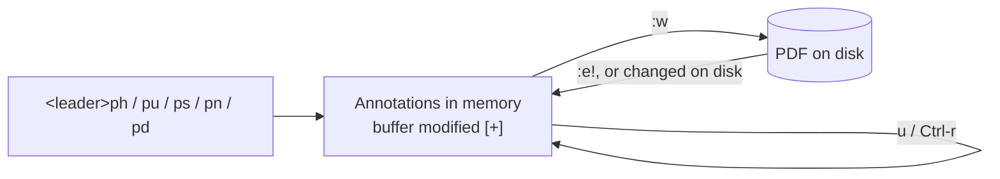

# Annotations, notes and snapshots

- [Annotations](#annotations)
- [Saving and undo](#saving-and-undo)
- [Typst notes](#typst-notes)
- [Snapshots for agents](#snapshots-for-agents)

The keys are listed in [Usage](usage.md#annotations-and-snapshots).

## Annotations

pdfview creates highlights, underlines and strikethroughs. These are standard PDF
annotations, so any PDF viewer shows them. pdfview also shows, lists, edits and deletes
annotations made in other programs, including squiggly underlines and text notes.

An annotation that carries a note has a small square just past its end, in a darker
shade of its colour, like a footnote mark. The square is drawn on screen only, never
into the PDF.

## Saving and undo

A PDF works like any file you edit in Neovim:

- New annotations stay in memory until you save, and the buffer shows as modified.
- `:w` saves them into the PDF, adding to the end of the file and leaving the rest
  untouched. `:w other.pdf` writes a copy.
- `:e!` throws away unsaved annotations and reloads the PDF. `:e` refuses while there
  are unsaved changes.
- `u` and `<C-r>` undo and redo creating, deleting and editing annotations. The history
  survives `:w`: undoing past the save marks the buffer modified again, and redoing
  back to it clears the mark.
- The history lasts until you close or reload the PDF. Nothing is saved automatically.

When the PDF changes on disk, for example when LaTeX recompiles it, pdfview reloads it.
If you have unsaved annotations, it warns you instead, and `:w` refuses to overwrite
the newer file. `:e!` loads the new version and discards your unsaved annotations.

## Typst notes

Notes you write in pdfview are [Typst](https://typst.app/docs/) documents, so they can
hold maths, for example `$ V = L^3 $`.

### Writing a note

`<leader>pn` on a selection highlights it and opens the note editor. On an existing
annotation, it edits that annotation's note.

The editor shows the source next to a live preview: side by side on a wide terminal,
one above the other on a tall one. Compile errors show as diagnostics on their lines,
and the preview keeps the last version that compiled.

- `:w` saves the note into the PDF in memory; `q` saves and closes.
- Saving an empty note removes it and leaves a plain highlight.
- Inside the editor, `u` undoes your typing, as in any buffer.

### Reading a note

`K` shows the note under the cursor, rendered. If it does not compile, `K` shows its
source. Moving the cursor closes it. Press `K` again to move into it, then `q` or
`<Esc>` to close. Reading a note never marks the PDF modified.

A rendered note wraps at the width of its window and shrinks to fit if it is too tall.
`typst_scale` in `setup()` sets its text size.

### Packages

A note can import packages from Typst Universe, such as
`#import "@preview/physica:0.9.3": *`. They are downloaded on first use into Typst's
usual cache, which the `typst` command shares if you have it. Notes cannot read files
from your disk.

### How notes are stored

A note is kept as Typst source in the annotation's ordinary note text, marked with a
private `/PdfviewTypst` key. Other PDF viewers ignore the key and show the source as a
plain note.

Notes written in other programs do not have the key, so `K` shows them as plain text.
Editing one with `<leader>pn` and saving turns it into a Typst note.

## Snapshots for agents

`<leader>py` saves what you see as one PNG for an AI agent. The image shows the visible
part of the pages, with the selection tinted and boxed in red. A caption strip below it
lists:

- the PDF's full path,
- the visible pages and the page count,
- the text of every note on the visible part of the pages,
- the selected text, up to 300 characters. Without a selection in cursor mode, it gives
  the cursor's page and the text around the cursor instead, with the character under
  the cursor in brackets and boxed in red on the image.

The PNG goes into `snapshot_dir` (default `$TMPDIR/pdfview`). On macOS it is also copied
to the clipboard; elsewhere its file name is shown. Taking a snapshot returns to pager mode.

One image works everywhere: give a local agent its path, or paste it into a web chat.
The model reads the page from the image. The caption adds what the image cannot show:
where the file is, the note text, and exactly which text you mean.
