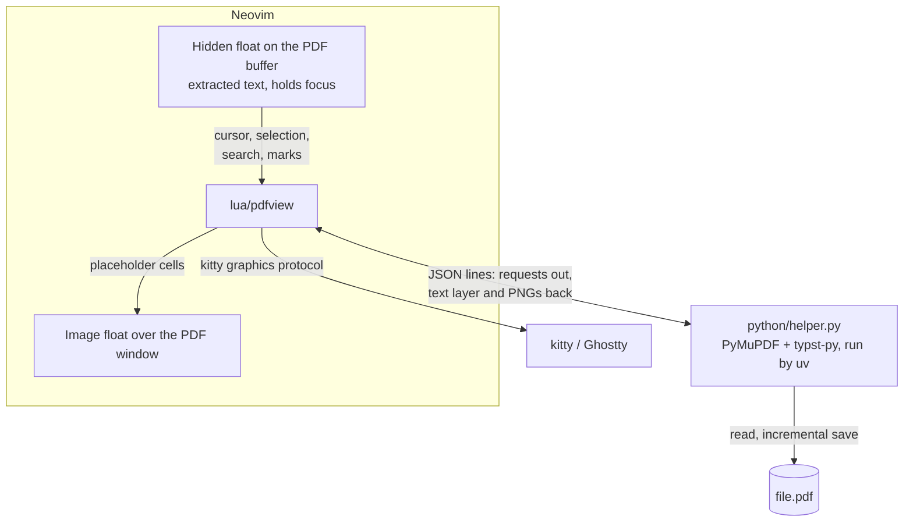

# Development

- [How it works](#how-it-works)
- [Filetypes and highlight groups](#filetypes-and-highlight-groups)
- [Tests](#tests)
- [Demos](#demos)

## How it works



**The helper.** `python/helper.py` does all the PDF work with PyMuPDF: it extracts the
text with each character's position, renders page regions, edits annotations, builds
snapshots and renders Typst notes with typst-py. Neovim starts one helper per session
with `uv run --script` and talks to it in JSON lines. uv installs the helper's locked
dependencies (`python/helper.py.lock`) into a cached environment on first use.

**Two windows.** The PDF window is covered by a float that shows the rendered pages and
never takes focus. A second, hidden float holds the extracted text and the keyboard
focus, so Vim's own motions, operators, search and marks work unchanged; pdfview maps
only the keys that act on the view. The hidden float shares the PDF window's jumplist
and alternate file. Switching buffers from it switches the PDF window, and closing it
closes the PDF window.

**Drawing.** Images use the kitty graphics protocol with Unicode placeholders
(`lua/pdfview/kitty.lua`). The image is drawn through placeholder characters in a
buffer, so splits and floats cover it correctly. Rendered pages reach the terminal as
temporary files, which the terminal deletes after reading. The scrollbar is drawn as
vector shapes on a small page and turned into pixels in one call, which keeps
navigation fast.

## Filetypes and highlight groups

Filetypes: `pdfview` for the text buffer, `pdfview_page` for the image float.

Highlight groups, all of which you can override: `PdfViewHighlight`,
`PdfViewUnderline`, `PdfViewStrikeOut`, `PdfViewSquiggly`, `PdfViewNote` and
`PdfViewPage`.

## Tests

```sh
uv run --with 'pymupdf>=1.26,<1.27' --with 'typst>=0.15,<0.16' tests/test_helper.py
```

This runs the helper tests and a headless Neovim scenario that uses the real helper,
with only terminal graphics replaced. They cover page layout and clipping, hit testing,
snapshots, the cursor, selections, note previews, Typst notes (live preview,
diagnostics, rendered hover), annotation undo and redo, the modified flag, and keeping
annotations intact through saves, including repaired PDFs.

To include the Leap test, set `PDFVIEW_LEAP_RTP` to your `leap.nvim` directory.

## Demos

[demo/README.md](demo/README.md) has the source of the demo PDF and explains how the
clips and screenshots in `docs/media/` were recorded.
