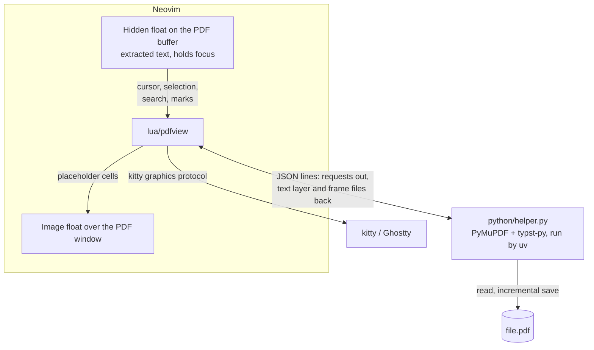

# Development

- [How it works](#how-it-works)
- [Filetypes and highlight groups](#filetypes-and-highlight-groups)
- [Tests](#tests)
- [Benchmarking](#benchmarking)
- [Demos](#demos)

## How it works



**The helper.** `python/helper.py` does all the PDF work with PyMuPDF: it extracts the
text with each character's position, renders page regions, edits annotations, builds
snapshots and renders Typst notes with typst-py. Neovim starts one helper per session
with `uv run --script` and talks to it in JSON lines. uv installs the helper's locked
dependencies (`python/helper.py.lock`) into a cached environment on first use.

**Two windows.** The PDF window is covered by a float that shows the rendered pages and
never takes focus. A second, hidden float holds the extracted text and the keyboard
focus, so Vim's own motions, operators, search and marks work unchanged; pdfview maps
only the keys that act on the view. The hidden float shares the PDF window's jumplist
and alternate file. Switching buffers from it switches the PDF window, and closing it
closes the PDF window.

**One buffer per file.** PDF and HTML files are read by a `BufReadCmd`, which
loads the document into the file's own buffer: on open, on `:e`/`:e!`, and when
the file changes on disk. `python/html_helper.py` lays HTML out in Chromium the
way the PDF helper reads pages. `:HtmlSource` rereads the same buffer as plain
HTML source, and `:HtmlView` reads it back into the rendered view.

**Drawing.** Images use the kitty graphics protocol with Unicode placeholders
(`lua/pdfview/kitty.lua`). The image is drawn through placeholder characters in a
buffer, so splits and floats cover it correctly. Frames reach the terminal as temporary
files of raw RGB, which the terminal deletes after reading. Each frame replaces the
pane's image under the same id. The helper rasterizes each page once and keeps it, and
it caches the scrollbar track too, so a PDF scroll step mostly copies pixels. PDF and
HTML share the scrollbar painter; HTML lays out the page in a narrower Chromium
viewport so the bar sits beside the content instead of on top of it.
The HTML viewport uses CSS pixels, with Chromium's device scale estimated from
the terminal cell height. Frames and text geometry use backing pixels, keeping
text readable on Retina displays without enlarging a low-resolution bitmap.
HTML freezes the page and caches RGB strips rather than taking screenshots on
every scroll. The helper sends text at layout time for native Vim commands, but
measures wrapped lines and character boxes only when the viewer needs coordinates.

## Filetypes and highlight groups

Filetypes: `pdfview` for the PDF text buffer, `htmlview` for the rendered HTML
buffer, `pdfview_page` for the image float.

Highlight groups, all of which you can override: `PdfViewHighlight`,
`PdfViewUnderline`, `PdfViewStrikeOut`, `PdfViewSquiggly`, `PdfViewNote` and
`PdfViewPage`.

## Tests

```sh
uv run --with 'pymupdf>=1.26,<1.27' --with 'typst>=0.15,<0.16' tests/test_helper.py
```

This runs the helper tests and a headless Neovim scenario that uses the real helper,
with only terminal graphics replaced. They cover page layout and clipping, the page and
scrollbar caches, hit testing, snapshots, the cursor, selections, note previews, Typst
notes (live preview, diagnostics, rendered hover), annotation undo and redo, the
modified flag, and keeping annotations intact through saves, including repaired PDFs.

To include the Leap test, set `PDFVIEW_LEAP_RTP` to your `leap.nvim` directory.

For the HTML regression test, install Chrome or Playwright Chromium as described
in the README, then run:

```sh
uv run --with 'playwright>=1.55,<2' --with 'pymupdf>=1.26,<1.27' tests/test_html_helper.py
```

## Benchmarking

```sh
nvim --headless -u NONE -i NONE -l tests/bench.lua docs/demo/notes.pdf
```

This times each stage of a frame while scrolling. Set `PDFVIEW_PROFILE=1` to record
frames in a live session. [benchmarking.md](benchmarking.md) explains the stages, the
caches and the reference numbers.

## Demos

[demo/README.md](demo/README.md) has the source of the demo PDF and explains how the
clips and screenshots in `docs/media/` were recorded.
