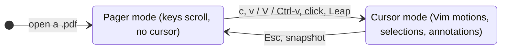

# Usage

- [Pager and cursor mode](#pager-and-cursor-mode)
- [Keys](#keys)
- [Search and selection](#search-and-selection)
- [Marks and jumps](#marks-and-jumps)
- [Scrollbar](#scrollbar)
- [Leap](#leap)
- [Statusline](#statusline)

## Pager and cursor mode

A PDF opens with its pages stacked one after another, so you scroll through the whole
document.



**Pager mode** works like `less`: keys scroll the pages and no cursor is drawn. The
cursor quietly stays on the top line in view, so cursor mode starts where you are
reading.

**Cursor mode** is Vim on the page text: motions, `/`, marks, visual mode and yanking all
work. The view follows the cursor, tints its line or selection and boxes the character
under it. The cursor turns hollow when you leave the PDF window or the terminal loses
focus.

To enter cursor mode, press `c`, start a selection with `v`, `V` or `<C-v>`, click on a
page, or start a Leap jump. To go back to pager mode, press `<Esc>` in normal mode (the
first `<Esc>` ends a selection), cancel a Leap jump, or take a snapshot. Your own
`<Esc>` mapping, such as `:nohlsearch`, still runs.

## Keys

All keys are mapped only in PDF buffers.

### Pager mode

| Key | Action |
| --- | --- |
| `j` / `k`, `<Down>` / `<Up>`, `<CR>` | Scroll down / up three rows (takes a count) |
| `d` / `u` | Scroll half a view (a count scrolls that many rows) |
| `gg` / `G` | Go to the start / end |
| `c` | Cursor mode |

In cursor mode these keys do what they do in Vim, and `u` undoes annotation changes.

### Both modes

| Key | Action |
| --- | --- |
| `<C-e>` / `<C-y>` | Scroll one row (takes a count) |
| `<C-d>` / `<C-u>` | Scroll half a view (a count scrolls that many rows) |
| `<C-f>` / `<C-b>` | Scroll a view, keeping two rows of overlap (takes a count) |
| Mouse wheel | Scroll |
| `zt` / `zz` / `zb` | Put the cursor line near the top / middle / bottom |
| `H` / `M` / `L` | Move to a line near the top / middle / bottom |
| `]p` / `[p`, `<C-j>` / `<C-k>`, `<PageDown>` / `<PageUp>` | Go to the top of the next / previous page; inside a page, `[p` goes to its top first (takes a count) |
| Left click | Move the cursor to the character you clicked |

Scrolling keeps the cursor on screen. In other windows on the same buffer (see
[Search and selection](#search-and-selection)) these keys work as usual.

### Annotations and snapshots

`x` is visual mode, `n` normal mode.

| Key | Mode | Action |
| --- | --- | --- |
| `<leader>ph` | x | Highlight the selection |
| `<leader>pu` | x | Underline the selection |
| `<leader>ps` | x | Strike out the selection |
| `gn` | x | Highlight the selection and write a note on it |
| `gn` | n | Edit the note of the annotation under the cursor |
| `<leader>pd` | n | Delete the annotation under the cursor |
| `<leader>pl` | n | List all annotations in the quickfix list |
| `K` | n | Show the note under the cursor; press again to focus it |
| `u` / `<C-r>` | n | Undo / redo annotation changes (takes a count) |
| `]a` / `[a` | n | Next / previous annotation (takes a count) |
| `<leader>py` | n, x | Snapshot for an agent (copied to the clipboard on macOS) |

[Annotations, notes and snapshots](annotations.md) explains what they do.

## Search and selection

`/` searches the whole document. Matches are tinted on the page, and the match under
the cursor is orange, so `n` and `N` are easy to follow in pager mode too. Matches are
tinted within one line; a pattern that spans lines still moves the cursor.

Selections and yanks follow the text's reading order, not a rectangle on the screen.
Select with `v` or `V`; dragging the mouse does not select.

The page text is the PDF's extracted text layer. To read it as plain text, for example
to see what a yank will copy, `:split` the PDF window: other windows on the buffer show
the text.

## Marks and jumps

In PDFs, marks (`m`) and jumps remember the view. When `'a`, `` `a ``, `''`, `<C-o>`
or `<C-i>` takes you somewhere off screen, the page scrolls back to where it was
when you set the mark or left. Other moves scroll just enough to show the cursor.

In HTML, `ma` saves both scroll offsets. `'a` and `` `a `` restore that viewport
while keeping Vim's linewise and exact-column jumps, respectively. `''` returns
to the viewport you jumped from.

## Scrollbar

The bar at the right edge maps the whole document in PDF and HTML. In PDFs it also
shows page boundaries and annotations (with a darker end when they carry a note).
Both views show:

- lines matching the search, in orange,
- marks `a`–`z` and `'` (where `''` returns to), as small labels,
- in cursor mode, the cursor line as a blue rule,
- a see-through box over the part in view.

HTML reflows to leave a gutter for the bar. Its wheel pans the static document;
clicks do not activate links or controls.

In PDFs, a badge below the bar shows the page in the middle of the view and the page count,
after `CURSOR` in cursor mode. Its highlight group is `PdfViewPage`, linked to
`StatusLine` by default.

## Leap

With [leap.nvim](https://codeberg.org/andyg/leap.nvim), your Leap key jumps to anything
visible on the pages, including text in other columns. Keys you mapped to
`<Plug>(leap)` work in PDF buffers without extra setup, or you can choose a key with
`keys.leap`.

Type two characters, then press a label. Matching ignores case and follows Leap's
equivalence classes. A few things differ from Leap in a normal buffer:

- Labels appear after the second character, not the first.
- Repeating a jump asks for the two characters again.
- Labels sit on terminal cells, so two matches very close together can share a label.

pdfview draws its labels through Leap's `on_beacons` hook; a hook you set yourself still
runs.

## Statusline

The `[+]` for unsaved annotations needs `%m` in your statusline. The PDF window counts
as inactive, because a hidden window holds the keyboard focus, so `%m` must be in the
inactive statusline too. With `mini.statusline`:

```lua
require('mini.statusline').setup {
  content = {
    inactive = function() return '%#MiniStatuslineInactive#%F%m%=' end,
  },
}
```
